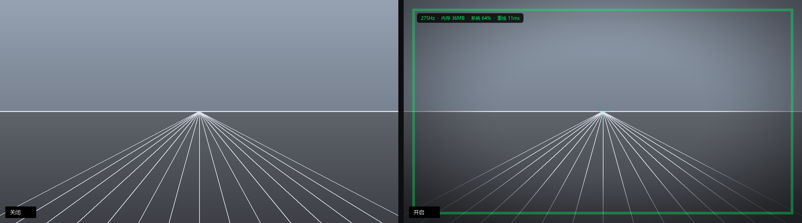

# Horizon

[简体中文](README.md) · [English](README.en.md) · [日本語](README.ja.md)

Horizon は、3D ゲームで映像酔いを感じやすいプレイヤー向けの Windows 用ツールです。画面の上にクリックを透過する静止オーバーレイを表示します。周辺を暗くするビネットと、カメラに追従しない枠線・中央マーカーを組み合わせ、固定した視覚的な目印を置きます。

**[Horizon.exe をダウンロード](https://github.com/Peanut123467/horizon-overlay/releases/latest)** · Windows 10 / 11 · インストール不要 · Apache-2.0

**v0.2.2**：ビネットのパラメーター、設定ファイルの復旧、複数モニターの情報取得、パネルの同期を修正しました。ビネットのキャッシュを削減し、英語・日本語の説明を追加しました。[変更履歴](CHANGELOG.md)も参照してください。



> 本ツールは映像表示の補助を目的としたもので、医療機器ではありません。診断・治療を行わず、効果を保証しません。気分が悪くなったらプレイを中止し、症状が続く場合は専門家に相談してください。外部オーバーレイがアンチチートに許可される保証はないため、競技系オンラインゲームでは使用しないでください。

## 機能と動作範囲

- 調整可能なビネット、枠線、中央の照準マーカー、任意のドットグリッド。
- 画面の四辺に配置する三角形の目印。輪郭のみ／塗りつぶし、底辺幅、奥行き、線幅、不透明度を調整できます。
- ローカルのコントロールパネル。模擬画面のライブプレビュー、プリセット、配色、モニター選択、設定のインポート／エクスポートに対応。
- 通知領域のメニュー、変更可能なグローバルショートカット、ローカルの休憩リマインダー。
- オーバーレイを表示しているモニターのリフレッシュレート、本プロセスのメモリ、システムメモリ使用率、直近の全画面再描画時間を表示する HUD。
- DLL インジェクション、グラフィックス API のフック、ゲームプロセスへのアクセス、ゲームファイルの変更、ネットワーク通信、テレメトリー、健康情報の収集は行いません。

**アプリ本体のパネルと通知領域メニューは現在中国語です。** この README は操作説明の日本語版です。[中国語の詳しいパネルガイド](docs/控制面板.md)もあります。

## 必要環境と導入

オーバーレイには Windows 10 または 11 が必要です。ゲームの表示モードは**ボーダーレスウィンドウ**または**ウィンドウ**にしてください。排他フルスクリーンでは通常、デスクトップ合成を経由しないため表示されません。一度に覆えるモニターは 1 台です。ソースから実行する場合のみ Python 3.10 以降が必要です。

### 実行ファイルを使う

1. [Releases](https://github.com/Peanut123467/horizon-overlay/releases/latest) から `Horizon.exe` をダウンロードするか、Windows 用 ZIP を展開します。
2. `D:\Tools\Horizon\` など、継続して使うフォルダーに保存します。
3. ダブルクリックして **Horizon 控制台**（コントロールパネル）を開きます。
4. **启动叠加层**（オーバーレイを開始）を押します。通知領域にアイコンが現れ、画面にオーバーレイが表示されます。

単一ファイル版は起動時に一時フォルダーへ展開されます。起動時間やメモリ使用量は、PC、解像度、パネルを開いているかどうかで変わります。通常、管理者権限は不要です。ウイルス対策ソフトが PyInstaller 製の実行ファイルを検出する場合がありますが、すべて誤検出だと決めつけず、ファイルとソースを確認してください。

### ソースから実行する

```bat
git clone https://github.com/Peanut123467/horizon-overlay.git horizon-overlay
cd horizon-overlay
python -m venv .venv
.venv\Scripts\activate
pip install -e .
horizon --self-test
horizonw
```

`horizonw` はコンソールなしでパネルを開きます。`horizon` は診断用のコンソールを残します。`self-test OK` と表示されれば、ウィンドウを開かずに行う描画チェックは成功です。

## 基本操作

パネルからオーバーレイを開始し、ゲームをボーダーレスまたはウィンドウモードで起動します。遮蔽を弱くしたい場合は「軽微」プリセットから試してください。**パネルを閉じても、起動済みのオーバーレイは通知領域で動作を続けます。**

| 中国語の表示 | 日本語での意味 |
| --- | --- |
| 启动叠加层 / 停止叠加层 | オーバーレイを開始／停止 |
| 显示 / 隐藏 | 終了せずに表示／非表示 |
| 轻微 / 标准 / 强 | 弱／標準／強のプリセット |
| 暗角 / 边框 / 中心准星 | ビネット／枠線／中央マーカー |
| 四边三角 / 空心 / 实心 | 四辺の三角形／輪郭のみ／塗りつぶし |
| 锚点阵 / 统计面板 / 休息提醒 | ドットグリッド／統計 HUD／休憩リマインダー |
| 恢复默认 / 导入配置 / 导出配置 | 初期設定に戻す／設定を読み込む／設定を書き出す |
| 登录 Windows 后打开控制面板 | Windows サインイン後にパネルを開く |
| 打开控制面板 / 退出 | パネルを開く／終了 |

スライダーを動かしている間も、プレビューと起動中のオーバーレイは更新されます。未処理の変更をまとめて送るため、更新待ちが増え続けることを防ぎます。実際の更新速度は描画負荷によって変わります。パネルを閉じる前に最後の変更を保存します。設定の同期時も、フォーカス、スクロール位置、開閉グループの状態を維持します。

通知領域のアイコンを右クリックすると、パネルを開く、効果を切り替える、プリセット・配色を選ぶ、設定を再読み込みする、設定フォルダーを開く、終了するといった操作ができます。左クリックでは表示／非表示を切り替えます。Windows 11 でアイコンが見えない場合は、タスクバーの `^` を開いて外へドラッグするか、通知領域の設定で Horizon を表示してください。初回のオーバーレイ起動時は、アイコンの場所を案内するメッセージが 8 秒間表示されます。

サインイン時に開く設定を有効にすると、次回サインイン後にパネルが開きます。オーバーレイは開始ボタンを押すまで起動しません。通常の終了には、アイコンを右クリックして **退出**（終了）を選ぶか、パネルから停止してください。

## グローバルショートカット

| 初期設定 | 操作 | 代替キー |
| --- | --- | --- |
| `Ctrl+Alt+H` | 表示／非表示 | `Ctrl+Alt+F9` |
| `Ctrl+Alt+1` | 弱プリセット | `Ctrl+Alt+F7` |
| `Ctrl+Alt+2` | 標準プリセット | `Ctrl+Alt+F8` |
| `Ctrl+Alt+3` | 強プリセット | — |
| `Ctrl+Alt+T` | 中央マーカーの切り替え | `Ctrl+Alt+F10` |
| `Ctrl+Alt+S` | 統計 HUD の切り替え | `Ctrl+Alt+F11` |
| `Ctrl+Alt+C` | 強調色を順に切り替え | `Ctrl+Alt+F12` |
| `Ctrl+Alt+Q` | オーバーレイを終了 | — |

初期設定のキーが使用中の場合は代替キーを試し、実際に登録した組み合わせを起動ログに記録します。パネルの **快捷键** で操作をクリックし、Ctrl と英字・数字・F1～F12 の組み合わせを押すと変更できます。Alt と Shift も併用できます。重複したキーや他のアプリが使用しているキーは拒否されます。Esc で入力を取り消します。

## プリセット

| 名前 | ビネット開始位置／強度 | 枠線 | 内容 |
| --- | --- | --- | --- |
| `gentle` | 0.55 / 0.35 | 6 px | 周辺を軽く暗くする |
| `standard` | 0.34 / 0.55 | 8 px | 初期設定の外観 |
| `strong` | 0.20 / 0.78 | 10 px | 遮蔽が強め。短時間の利用向け |

プリセットが変更するのは、ビネット、枠線、中央マーカー、ドットグリッドです。強調色、モニター、四辺の三角形など、その他の設定は維持します。「初期設定に戻す」ではすべてを戻し、四辺の三角形も無効になります。

## 設定ファイルと復旧

既定の保存先は `%APPDATA%\horizon\config.json` です。通常、パネルや通知領域メニューからの変更は自動保存されます。ファイルを直接編集した場合は、通知領域メニューの **重新载入配置**（設定を再読み込み）を選んでください。

設定は**厳密な JSON** で、コメントや末尾のカンマは使えません。以下は主な初期値です。省略した項目には既定値を使います。

```json
{
  "vignette": { "enabled": true, "inner": 0.34, "outer": 1.06, "strength": 0.55 },
  "frame": { "enabled": true, "inset": 26, "width": 8, "alpha": 90 },
  "triangles": { "enabled": false, "filled": false, "base": 50, "depth": 20, "width": 3, "alpha": 153 },
  "reticle": { "enabled": true, "size": 9, "gap": 9, "alpha": 150 },
  "grid": { "enabled": false, "spacing": 180, "radius": 2, "alpha": 16 },
  "session": { "enabled": true, "minutes": 60, "reminder_seconds": 3 },
  "stats": { "enabled": true, "position": "top-left", "font_size": 21, "alpha": 200, "refresh_ms": 1000 },
  "color": "#00FF66",
  "monitor": 0,
  "start_hidden": false
}
```

- ビネットの半径は正規化した距離で、0 は中央、1 は隅です。半径の大小が逆なら並べ替え、グラデーションの幅を最低 0.05 に保ちます。パネルのスライダーも連動して範囲を制限します。強度は 0～1 です。
- 枠線の内側への距離・線幅、中央マーカーのサイズ・間隔、グリッドの間隔・半径はピクセル単位です。枠線の内距が大きすぎる場合は、描画時に画面サイズに合わせて制限します。
- 三角形の `base` と `depth` は画面に対する割合（1～100%）です。`filled` が塗りつぶし、`width` が輪郭の線幅です。不透明度 `alpha` は 0～255 です。
- `color` は `#RRGGBB` または `#RGB` を受け付けます。目印と HUD の文字色に適用され、ビネットの暗さには色を付けません。
- モニター番号 0 はメインモニターです。HUD の位置は `top-left`、`top-right`、`bottom-left`、`bottom-right`、更新間隔は `refresh_ms` で指定します。
- 任意の `hotkeys` オブジェクトで、`toggle`、`gentle`、`standard`、`strong`、`reticle`、`stats`、`color`、`quit` にキー文字列を割り当てられます。
- 真偽値は JSON の `true`／`false` を推奨します。文字列の `true/false`、`1/0`、`yes/no`、`on/off` も認識し、不明な値は元の設定を維持します。

解析に失敗した場合や、JSON の最上位がオブジェクトでない場合は、元のファイルを固有の `config.json.bak-<日時>-<識別子>` へ移してから初期設定を使います。バックアップ先は警告ログに記録します。読み取りやバックアップに失敗した場合は、上書きを避けるため復旧処理を中止します。通常の保存では、一つ前のファイルを `config.json.bak` に残します。

## HUD と休憩リマインダー

HUD は、オーバーレイがあるモニターのリフレッシュレート、オーバーレイプロセスのワーキングセット、システムの物理メモリ使用率、直近の全画面再描画時間を表示します。リフレッシュレートを取得できない場合やドライバーが 0／1 を返した場合は、その項目を表示しません。**ゲームの FPS ではありません。** ゲームのフレーム計測や ETW コンシューマーは実装していません。

HUD は独立した小さなウィンドウです。全画面の合成は、外観・解像度・通知の文字列が変化したときに行います。スライダー操作中も更新しますが、同じ内容は再描画しません。性能は PC と解像度に依存します。ビネットのキャッシュは直近のアルファ画像 1 枚のみで、4K では約 7.9 MiB です。一時配列、ウィンドウの描画面、パネルのプロセスはこの値に含みません。

休憩通知にはローカルタイマーを使います。初期設定は 60 分間隔、表示時間は 3 秒です。実行中に間隔を短くした場合も、通知には現在のリマインダー周期で実際に経過した分数を表示します。健康状態を判定する機能ではありません。

## コマンドライン

```bat
horizon
horizon --overlay
horizon --preset strong --monitor 1
horizon --color "#00E5FF"
horizon --no-stats
horizon --preview out.png --compare
horizon --preview out.png --size 1200x675
horizon --self-test
horizon --print-config
horizon --duration 5 --no-tray
horizon --config my.json
horizon --version
```

`--preset`、`--color`、`--monitor`、`--no-stats` を指定すると**一時的なセッション**になります。パネルには一時セッションであることを表示し、実際に動作中の設定を読み取ります。その実行中の変更は保存済みの設定へ書き戻しません。設定を保存したい場合は、そのセッションを停止してから通常どおりパネルで変更してください。`--duration 0` は初期化後にすぐ終了するよう予約します。

## トラブルシューティングと制限

| 症状 | 確認すること |
| --- | --- |
| ゲーム上に表示されない | ボーダーレス／ウィンドウモードに変更します。必要に応じてゲーム実行ファイルのプロパティで全画面最適化を無効にしてください。 |
| 通知領域のアイコンがない | タスクバーの `^` や通知領域の設定を確認します。 |
| `horizon` が見つからない | 仮想環境を有効にするか、Python の Scripts フォルダーの PATH を確認します。 |
| 起動やパネルのエラー | `%APPDATA%\horizon\horizon.log` を確認するか、コンソールから `horizon` を実行します。 |
| パネルが黒い | WebView2 とグラフィックスドライバーを更新します。改善しない環境では下記の明示的な回避策を試せます。 |
| 効果変更時に一瞬止まる | 全画面の合成には処理時間がかかり、高解像度ほど負荷が増えます。HUD の実測値を参照してください。 |
| HDR で色が異なる | オーバーレイは SDR で合成されます。 |
| 複数モニター | 選択した 1 台だけを覆います。同時表示は未実装です。 |

GPU の互換用オプションは既定では無効です。必要な環境のみ、PowerShell で次のように設定し、同じウィンドウから起動してください。

```powershell
$env:HORIZON_WEBVIEW_ARGS = '--in-process-gpu'
.\Horizon.exe
```

これは WebView2 のプロセス構成を変更する回避策で、一部のドライバー、仮想マシン、リモート環境を対象とします。この PowerShell を閉じるか、環境変数を削除すると指定を解除できます。

アンチチートとの互換性は保証できません。ゲームの描画処理やロジックは変更せず、毎フレームのアニメーション、ゲーム FPS、複数モニターへの同時表示も実装していません。

## 開発と貢献

```bat
pip install -e ".[dev]"
python -m pytest -q
node --test tests/live_updates.test.cjs
python -m ruff check src tests tools
python -m ruff format --check src tests tools
python -m horizon --self-test
```

GitHub Actions は Windows／Linux、Python 3.10／3.12 をチェックします。Windows では全単体テスト、Linux では設定・ショートカット検証・描画などの共通ロジックを実行し、Win32 依存のテストをスキップします。GUI アプリの Linux 対応を意味するものではありません。Windows では `python tools/console_smoke.py` で独立した設定を使う実パネルのテスト、`python tools/integration_smoke.py` で別プロセスのオーバーレイのテストを行えます。結合テスト前には既存の Horizon ウィンドウを閉じてください。

主なモジュールは `config.py`（検証・保存）、`render.py`（numpy／Pillow による合成）、`win32.py`（ctypes バインディング）、`overlay.py`（ウィンドウ・キー・タイマー）、`metrics.py`（ローカル情報）、`console/`（パネル）、`tray.py`（通知領域メニュー）です。実行ファイルを作るには PyInstaller をインストールして `python tools/build_exe.py` を実行します。

今後の候補は、ETW によるゲーム FPS、設定の自動再読み込み、マスク形状の追加、複数モニターへの同時表示、メモリ削減です。現在利用できる機能ではありません。

不具合報告、プリセット、動作環境の情報、ドキュメントの改善は [Issues](https://github.com/Peanut123467/horizon-overlay/issues) へどうぞ。健康情報や効果を保証する主張は含めないでください。ライセンスは [Apache-2.0](LICENSE) です。
