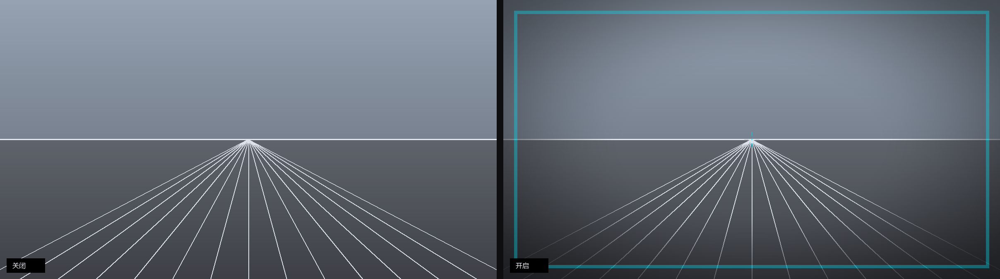

# Horizon

给 3D 游戏画面盖一层**可点击穿透的静态叠加层**：用暗角收窄周边视野，用固定边框和中心锚点给眼睛一个不动的参照物

**不注入游戏进程、不读写游戏文件、不联网、不采集任何数据**。它只是屏幕最上层的一张透明图，运行时常驻在右下角托盘里，右键即可退出


> **免责声明**  
> 本项目是一个画面辅助工具，**不是医疗器械，也不提供诊断或治疗**。晕动症的成因因人而异，本项目**不承诺任何效果**  
> 如果你在游玩后持续出现明显不适，请停止游玩并咨询专业人士  
> 竞技类联机游戏请勿使用：叠加层虽然不注入进程，但仍无法保证不被反作弊误判

---

## 一、它做什么 / 不做什么

| 做                         | 不做                     |
| ------------------------- | ---------------------- |
| 在屏幕最上层画静态暗角、边框、中心锚点（颜色可调） | 不注入 DLL、不 hook 图形 API  |
| 常驻系统托盘，随时开关、随时退出          | 不读写任何游戏配置文件            |
| 全局热键切换预设与颜色               | 不联网、不上传、不采集健康数据        |
| 本地会话计时 + 轻量休息提示           | 不显示游戏 FPS（不注入就拿不到，见下文） |
| 显示刷新率、本程序内存、系统内存（本地统计）    | 不修改游戏画面、不改变游戏逻辑        |
| 单显示器、多分辨率自适应              | —                      |

---

## 二、环境要求

- Windows 10 / 11（依赖分层窗口 `UpdateLayeredWindow`，**不支持** macOS / Linux）
- **用 exe 版：无需安装任何东西**，双击即用
- 用源码版：Python 3.10+
- **游戏需运行在「无边框窗口」或「窗口」模式**——独占全屏下叠加层不会显示（这是 Windows 的合成器行为，不是 bug）

---

## 三、安装

### 方式 A：直接用 exe（推荐，不用装 Python）

1. 到仓库的 **Releases** 页下载 `Horizon.exe`；
2. 放到一个固定文件夹，例如 `D:\Tools\Horizon\`（**不要放下载目录**，容易被清理）；
3. **双击 `Horizon.exe`**；
4. 右下角托盘出现绿色小图标，屏幕上出现暗角 + 绿色边框，就是启动成功了。

首次启动需要 1–3 秒（单文件 exe 要先解压到临时目录），之后常驻内存约 70MB。

> **杀毒软件报毒怎么办**
> PyInstaller 打包的 exe 被启发式引擎误报是常见现象，不是本项目的行为问题。可以把文件加入信任列表，或者改用下面的「方式 B」从源码运行——源码运行不会有任何报毒。

### 方式 B：从源码运行

需要 Python 3.10 或更高版本（安装时勾选 *Add Python to PATH*）。

```bat
git clone https://github.com/Peanut123467/horizon-overlay.git horizon-overlay
cd horizon

python -m venv .venv
.venv\Scripts\activate

pip install -e .
```

安装完成后有两个命令：

| 命令 | 用途 |
| --- | --- |
| `horizonw` | **日常用这个**，无控制台窗口，纯托盘常驻 |
| `horizon` | 带控制台，能看到实时日志，排查问题时用 |

验证是否装好：

```bat
horizon --self-test
```

看到 `self-test OK` 就说明渲染管线正常。

### 安装常见问题

| 现象 | 原因与解决 |
| --- | --- |
| `'horizon' 不是内部或外部命令` | 虚拟环境没激活（先跑 `.venv\Scripts\activate`），或 Python 的 `Scripts` 目录不在 PATH |
| 双击 exe 后毫无反应 | 看日志：`%APPDATA%\horizon\horizon.log` |
| 托盘里找不到图标 | Windows 11 默认把新图标折叠进 `^` 溢出区。点开 `^` 把 Horizon 拖到任务栏；或 设置 → 个性化 → 任务栏 → 其他系统托盘图标 → 打开 Horizon |
| 屏幕上什么都没有 | 游戏在独占全屏模式；改成「无边框窗口」 |
| 提示权限错误 | 不需要管理员权限，普通用户运行即可 |

---

## 四、启动后怎么用

这个程序**没有主窗口**，所有操作都在托盘图标和全局热键里。

### 第一次使用的四步

1. **双击 `Horizon.exe`**（或命令行 `horizonw`）；
2. 看右下角——有个绿色圆环图标，说明程序在跑；
3. **把游戏设为「无边框窗口」**，然后正常进游戏，叠加层会盖在游戏画面上；
4. 觉得挡视线或太强，按 `Ctrl+Alt+1` 换轻微档，或按 `Ctrl+Alt+H` 临时关掉。

### 退出

**右键托盘图标 → 退出。**

这是唯一正确的退出方式。直接关控制台窗口或用任务管理器结束进程也能关，但那样不会保存你刚用热键改过的设置。

### 图标被折叠进 `^` 里了？

Windows 11 默认把新出现的托盘图标塞进溢出区，所以第一次启动时你可能只看到屏幕上的暗角，却在右下角找不到图标。两种办法让它常驻：

- **拖出来**：点任务栏的 `^`，按住 Horizon 图标拖到任务栏上；
- **用设置**：设置 → 个性化 → 任务栏 → 其他系统托盘图标 → 把 Horizon 打开。

首次启动时，叠加层底部会显示一行提示（8 秒后自动消失），告诉你图标在托盘里、右键可退出——之后不再打扰。

### 临时开关

按 `Ctrl+Alt+H` 可以随时隐藏/显示叠加层，**进程仍在托盘里跑**，再按一次就回来。看剧情、截图时很有用。

### 调整外观

**右键托盘图标**，菜单里能直接改：颜色、预设、暗角强度、显示哪些元素（边框 / 准星 / 锚点阵 / 统计面板）。改完立刻生效，也会写回配置文件。

习惯键盘的话，用下面第七节的快捷键也一样。

### 让它开机自启（可选）

1. 按 `Win + R`，输入 `shell:startup`，回车；
2. 把 `Horizon.exe` 的**快捷方式**（不是 exe 本身）拖进打开的文件夹。

下次开机就会自动挂在托盘里。

---

## 五、托盘菜单

右键托盘图标可以看到：

| 菜单项 | 作用 |
| --- | --- |
| **显示 / 隐藏叠加层** | 同 `Ctrl+Alt+H`。左键单击图标也是这个效果 |
| **颜色** ▸ | 五个预设色单选，当前颜色前有圆点；选中后托盘图标同步变色 |
| **预设** ▸ | 轻微 / 标准 / 强 单选。手改过参数后不会有任何一项被选中，这是正常的 |
| **暗角强度** ▸ | 关闭 / 轻 / 中 / 强 单选 |
| **显示元素** ▸ | 边框、中心准星、锚点阵、统计面板，四项独立勾选 |
| **重新载入配置** | 改完 `config.json` 后不用重启，点这个立即生效 |
| **打开配置文件夹** | 直接打开 `%APPDATA%\horizon\` |
| `Horizon v0.1.0` | 版本号，不可点击 |
| **退出** | 关闭程序并保存当前设置 |

所有改动**即时生效并写回 `config.json`**，不用重启。菜单里的圆点和勾选状态实时反映当前配置——用热键改过之后，再打开菜单也是对的。

> 说明：托盘菜单只负责发指令，真正的配置修改发生在叠加层线程里，所以不存在两个线程同时写配置的问题。

---

## 六、游戏内设置

叠加层能不能显示，取决于游戏的显示模式：

| 显示模式 | 叠加层 | 说明 |
| --- | --- | --- |
| 无边框窗口（Borderless） | ✅ 正常 | **推荐**，绝大多数游戏都有这个选项 |
| 窗口模式 | ✅ 正常 | 画面不铺满时，叠加层仍覆盖整块屏幕 |
| 独占全屏（Exclusive Fullscreen） | ❌ 不显示 | Windows 合成器行为，无法绕过 |

如果游戏设为无边框后仍然看不到叠加层，再检查一项：右键 exe → 属性 → 兼容性 → 勾选「**禁用全屏优化**」。

---

## 七、快捷键

| 快捷键          | 作用         | 备用键            |
| ------------ | ---------- | -------------- |
| `Ctrl+Alt+H` | 显示 / 隐藏叠加层 | `Ctrl+Alt+F9`  |
| `Ctrl+Alt+1` | 切换到「轻微」预设  | `Ctrl+Alt+F7`  |
| `Ctrl+Alt+2` | 切换到「标准」预设  | `Ctrl+Alt+F8`  |
| `Ctrl+Alt+3` | 切换到「强」预设   | —              |
| `Ctrl+Alt+T` | 开关中心准星     | `Ctrl+Alt+F10` |
| `Ctrl+Alt+S` | 开关统计面板     | `Ctrl+Alt+F11` |
| `Ctrl+Alt+C` | 循环切换颜色     | `Ctrl+Alt+F12` |
| `Ctrl+Alt+Q` | 退出         | —              |

若某个键位已被其他程序占用，程序会自动回退到备用键，并在启动日志里打印实际绑定结果（`hotkey: Ctrl+Alt+F9  显示/隐藏`）。

---

## 八、预设

| 预设         | 暗角起点 / 强度                  | 适用                 |
| ---------- | -------------------------- | ------------------ |
| `gentle`   | inner 0.55 / strength 0.35 | 只想让边缘柔一点，几乎无感      |
| `standard` | inner 0.34 / strength 0.55 | 默认值                |
| `strong`   | inner 0.20 / strength 0.78 | 短时间使用；遮挡明显，不建议长期开着 |

三个预设都可直接改配置微调

---

## 九、配置

路径：`%APPDATA%\horizon\config.json`（首次运行自动生成）。

```jsonc
{
  "vignette": { "enabled": true, "inner": 0.34, "outer": 1.06, "strength": 0.55 },
  "frame":    { "enabled": true, "inset": 26, "width": 8, "alpha": 90 },
  "reticle":  { "enabled": true, "size": 9, "gap": 9, "alpha": 150 },
  "grid":     { "enabled": false, "spacing": 180, "radius": 2, "alpha": 16 },
  "session":  { "enabled": true, "minutes": 40, "reminder_seconds": 15 },
  "stats":    { "enabled": true, "position": "top-left", "font_size": 14, "alpha": 200, "refresh_ms": 1000 },
  "color":    "#00FF66",
  "monitor": 0,
  "start_hidden": false
}
```

| 字段                                             | 含义                                                                    |
| ---------------------------------------------- | --------------------------------------------------------------------- |
| `color`                                        | 强调色，`#RRGGBB` 或 `#RGB`。作用于边框、准星、点阵和统计文字。**不影响暗角**——暗角是压暗遮罩，染色会让整个画面偏色 |
| `vignette.inner`                               | 暗角起始半径（0 = 从屏幕中心就开始压暗，1 = 到边角才压暗）                                     |
| `vignette.outer`                               | 达到最大强度的半径                                                             |
| `vignette.strength`                            | 最大不透明度（0–1）                                                           |
| `frame.inset`                                  | 边框距屏幕边缘的像素数                                                           |
| `frame.width`                                  | 边框粗细（像素）                                                              |
| `frame.alpha` / `reticle.alpha` / `grid.alpha` | 0–255 不透明度                                                            |
| `session.minutes`                              | 提醒间隔；`reminder_seconds` 是提示停留时长                                       |
| `stats.position`                               | `top-left` / `top-right` / `bottom-left` / `bottom-right`             |
| `stats.refresh_ms`                             | 统计面板刷新间隔，默认 1000ms                                                    |
| `monitor`                                      | 显示器索引，0 为主屏                                                           |

改完配置后重启程序生效（热重载在路线图里）。

---

## 十、颜色

默认是亮绿色 `#00FF66`。三种改法：

1. 改配置里的 `color` 字段，任何 `#RRGGBB` 都行；
2. 命令行临时指定：`horizon --color "#00E5FF"`；
3. 运行中按 `Ctrl+Alt+C` 在五个预设色之间循环（亮绿 → 青 → 白 → 暖黄 → 淡紫），自动写回配置

```bash
horizon --preview docs/my.png --color "#FFD60A"   # 先看一眼再决定
```

换成青色（`--color "#00E5FF" --no-stats`）的效果：



---

## 十一、统计面板

左上角（可改位置）显示一行本地指标：

```
275Hz  ·  内存 71MB  ·  系统 60%  ·  重绘 141ms
```

| 指标      | 含义                                                     |
| ------- | ------------------------------------------------------ |
| `275Hz` | 当前显示器刷新率（`GetDeviceCaps(VREFRESH)`；读到 0/1 时该项直接不显示，不猜） |
| `内存`    | **本程序自身**的工作集                                          |
| `系统`    | 物理内存占用率                                                |
| `重绘`    | 上一次全屏合成的耗时，只在切换预设/颜色时发生                                |

### 关于「游戏 FPS」——为什么这里没有

**不注入进程就拿不到游戏的帧率。** 这是硬约束，不是偷懒：

- 读 `Present()` 调用次数需要 hook 图形 API → 就是注入，本项目明确不做；
- 系统级唯一合规路径是 **ETW**（Intel PresentMon 走的路），需要实现 ETW 消费者并解析 DXGI 事件，属于独立工作量；
- 用轮询或桌面合成频率估算都不等于游戏 FPS，会给出误导性数字，所以宁可不显示

`重绘 141ms` 只在切换预设或颜色时触发一次，平时完全不重绘。这也是为什么统计面板单独占一个小窗口——全屏每秒重绘一次要吃掉约 10% 的 CPU

---

## 十二、命令行

```bash
horizon                                   # 启动叠加层
horizon --preset strong --monitor 1       # 指定预设与显示器
horizon --color "#00E5FF"                 # 临时换色
horizon --no-stats                        # 关掉统计面板
horizon --preview out.png --compare       # 生成「关 / 开」对比图，不弹窗
horizon --self-test                       # 渲染管线自检（可用于 CI）
horizon --print-config                    # 打印当前生效配置
horizon --duration 5 --no-tray            # 5 秒后自动退出，冒烟测试用
```

---

## 十三、原理与边界

叠加层只做三件基于**常见视觉诱因假设**的事：

1. **收窄周边视野**（暗角）——周边视野里的大面积光流是晕动的主要诱因之一。遮住边缘，等于减少参与运动的像素
2. **提供静态参照**（边框、中心准星、可选点阵）——让眼睛始终有一个不随镜头移动的锚点
3. **打断连续游玩**（会话计时）——疲劳会放大不适感

**这些都是假设，不是疗效结论。** 项目不做效果承诺，也没有能力做临床验证。仓库里不出现"有效缓解 X%"这类表述

**刻意不做的两件事**，以及原因：

- **不做逐帧动画 / 动态遮罩**：全屏 32 位分层窗口每帧重绘（1080p 约 8 MB/帧）本身就会影响帧时间，而帧时间抖动正是诱因之一。所以只在参数变化时重绘一次
- **不做进程注入 / 着色器后处理**：会被反作弊直接判定，且违反多数游戏 ToS。需要更强效果请自行使用 ReShade 类工具并自担风险，本项目不提供

---

## 十四、已知限制

| 限制         | 说明                                                 |
| ---------- | -------------------------------------------------- |
| 独占全屏不可见    | 请把游戏设为无边框窗口；部分游戏需同时关闭「全屏优化」                        |
| HDR 游戏     | 叠加层按 SDR 混合，颜色可能有偏差                                |
| 多显示器       | 一次只覆盖一个显示器（`monitor` 字段）                           |
| 反作弊        | 不注入，但第三方置顶窗口仍可能被个别反作弊拦截或标记；**竞技联机请勿使用**            |
| 切换预设时有一次卡顿 | 全屏重绘 1080p 约 60ms、1440p 约 140ms，仅在切换预设/颜色/分辨率时发生一次 |
| 内存占用       | Python + numpy + Pillow，常驻约 60–80MB，比原生 C++ 工具大    |
| exe 冷启动 1–3 秒 | 单文件 exe 每次启动要解压到临时目录；源码运行没有这个问题             |
| 无游戏 FPS    | 见上文「关于游戏 FPS」，不注入就拿不到                              |
| 游戏重设 z 序   | 已用 2 秒一次的看门狗重新置顶；极少数游戏可能仍然抢焦点                      |

---

## 十五、开发

```bat
pip install -e ".[dev]"
pytest -q
ruff check src tests && ruff format --check src tests
```

```
src/horizon/
  win32.py     纯 ctypes 的 Win32 绑定（分层窗口、热键、消息循环）
  render.py    numpy + Pillow 合成预乘 BGRA 像素
  overlay.py   双窗口生命周期、热键分发、会话计时、HUD 调度
  metrics.py   本地指标：本进程内存、系统内存、刷新率
  config.py    配置模型与 JSON 持久化
  tray.py      托盘图标（通过 PostMessage 与主窗口通信）
  __main__.py  命令行入口
tools/
  entry.py     PyInstaller 入口（绕开相对导入问题）
  build_exe.py 打包脚本 -> dist/Horizon.exe
assets/
  horizon.ico  程序图标（由 tray.make_icon_image 生成）
```

三个关键约束：

1. `render.compose()` 输出的是**预乘 alpha 的 BGRA**，这是 `UpdateLayeredWindow` 的要求；顺序错了会得到灰边
2. **主叠加层和统计面板是两个独立窗口**。全屏合成 1440p 要 140ms 左右，若每秒为刷新一个内存数字而重绘全屏，会稳定吃掉约 10% 的 CPU；HUD 单独一个约 250×30 的窗口，刷新成本低三个数量级
3. **无控制台运行时 `sys.stdout` 是 `None`**，裸 `print` 会抛异常。日志统一走 `_make_logger()`，无控制台时写 `%APPDATA%\horizon\horizon.log`

重新打包 exe：

```bat
python tools/build_exe.py
```

---

## 十六、路线图

- [ ] **游戏 FPS（ETW）** —— 唯一不注入的可行路径：实现 ETW 实时消费者，订阅 `Microsoft-Windows-DXGI` / D3D9 Present 事件，等价于 Intel PresentMon 的做法。工作量大，但能给出真实帧率与帧时间 P99
- [ ] 托盘菜单里加「开机自启」开关（现在要手动把快捷方式放进 `shell:startup`）
- [ ] 配置热重载（`ReadDirectoryChangesW`，现在要点托盘菜单手动重载）
- [ ] 按前台窗口标题自动切换预设（仅读窗口标题，不碰进程；**待验证**是否会被个别反作弊关注）
- [ ] 更多遮罩形状：上下条带、椭圆、可调中心偏移
- [ ] 多显示器同时覆盖
- [ ] 降内存：把 Pillow 从运行路径里去掉，直接用 numpy 光栅化，可省 20–30MB

---

## 十七、参与与许可

Apache-2.0，见 [LICENSE](LICENSE)

欢迎提交：预设参数、不同游戏/分辨率下的适配反馈、文档改进。请勿提交任何形式的健康数据或疗效宣称

---

## English summary

**Horizon** is a small Windows-only overlay for players who get motion discomfort in 3D games. It draws a static, click-through vignette plus a fixed border and centre anchor on top of the screen, narrowing peripheral optic flow and giving the eye a reference that does not move with the camera. It lives in the system tray — right-click the icon to quit, left-click to toggle.

## Install

**Option A — prebuilt exe (no Python needed):** download `Horizon.exe` from Releases, put it anywhere, double-click it. First launch takes 1–3 s while the one-file bundle unpacks. Windows Defender / antivirus heuristics sometimes flag PyInstaller bootloaders; that is a known false positive, not behaviour of this project.

**Option B — from source:**

```bat
git clone https://github.com/Peanut123467/horizon-overlay.git horizon-overlay
cd horizon
python -m venv .venv
.venv\Scripts\activate
pip install -e .
horizonw
```

`horizonw` runs without a console window (tray only); `horizon` keeps a console so you can watch the log. Verify with `horizon --self-test`.

## Use

1. Launch it — a green ring icon appears in the notification area and the vignette/border shows on screen.
2. Set the game to **borderless windowed** (exclusive fullscreen will not show overlays).
3. Adjust with `Ctrl+Alt+1/2/3` (presets), `Ctrl+Alt+H` (toggle), `Ctrl+Alt+C` (colour).
4. **Quit via right-click on the tray icon → 退出.** This saves your settings; killing the process does not.

The accent colour is configurable (default bright green `#00FF66`), and a small HUD shows the display refresh rate, this process's memory, system memory load, and the cost of the last full recomposition. There is deliberately **no game-FPS readout**: without injecting into the game or implementing an ETW consumer, that number cannot be obtained honestly.

It does **not** inject into the game, read or write game files, or phone home. It is **not** a medical device and makes **no efficacy claims**.

Built with Python, `ctypes` (Win32 layered window), numpy and Pillow. Licensed Apache-2.0.
